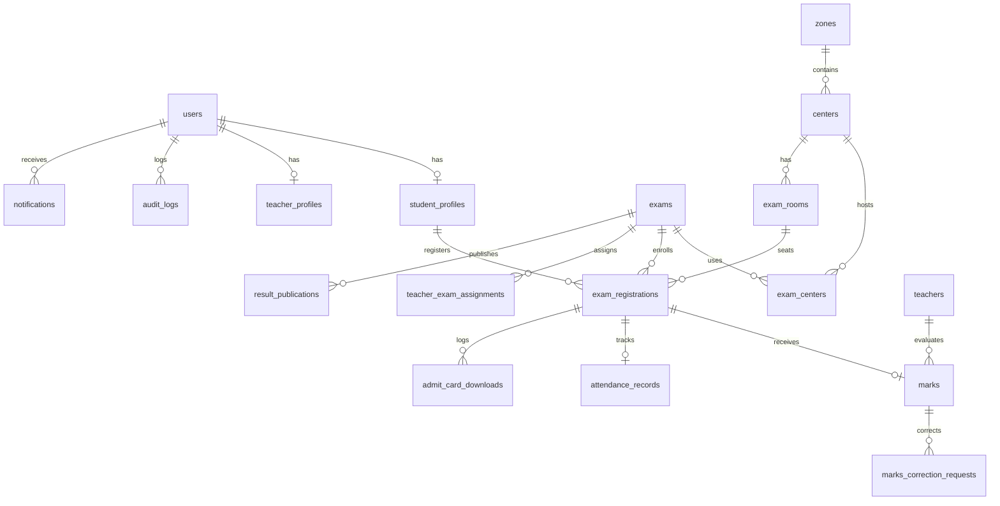

# NEXT MEDICALIAN – Database Schema & Architecture

---

### 1. Entity-Relationship Overview

The database is designed with normalized 3NF relational schemas, explicit foreign keys, cascading integrity, strict unique constraints, and high-performance indexes.



---

### 2. Table Specifications

#### 2.1 `users`
Core identity table for all three roles.
```sql
CREATE TABLE users (
    id BIGINT UNSIGNED AUTO_INCREMENT PRIMARY KEY,
    name VARCHAR(150) NOT NULL,
    username VARCHAR(50) NOT NULL UNIQUE,
    phone VARCHAR(20) NOT NULL,
    email VARCHAR(150) NULL UNIQUE,
    password VARCHAR(255) NOT NULL,
    role ENUM('admin', 'teacher', 'student') NOT NULL,
    is_active BOOLEAN NOT NULL DEFAULT TRUE,
    must_change_password BOOLEAN NOT NULL DEFAULT FALSE,
    last_login_at TIMESTAMP NULL,
    remember_token VARCHAR(100) NULL,
    created_at TIMESTAMP NULL,
    updated_at TIMESTAMP NULL,
    INDEX idx_users_role (role),
    INDEX idx_users_phone (phone)
);
```

#### 2.2 `student_profiles`
Detailed candidate metadata.
```sql
CREATE TABLE student_profiles (
    id BIGINT UNSIGNED AUTO_INCREMENT PRIMARY KEY,
    user_id BIGINT UNSIGNED NOT NULL UNIQUE,
    registration_number VARCHAR(20) NOT NULL UNIQUE,
    canonical_phone VARCHAR(20) NOT NULL UNIQUE,
    institution VARCHAR(150) NULL,
    hsc_batch VARCHAR(20) NULL,
    gender ENUM('male', 'female', 'other') NULL,
    address TEXT NULL,
    guardian_phone VARCHAR(20) NULL,
    photo_path VARCHAR(255) NULL,
    created_at TIMESTAMP NULL,
    updated_at TIMESTAMP NULL,
    FOREIGN KEY (user_id) REFERENCES users(id) ON DELETE CASCADE,
    INDEX idx_student_reg (registration_number),
    INDEX idx_student_phone (canonical_phone)
);
```

#### 2.3 `teacher_profiles`
Teacher professional details.
```sql
CREATE TABLE teacher_profiles (
    id BIGINT UNSIGNED AUTO_INCREMENT PRIMARY KEY,
    user_id BIGINT UNSIGNED NOT NULL UNIQUE,
    designation VARCHAR(100) NULL,
    institution VARCHAR(150) NULL,
    department VARCHAR(100) NULL,
    created_at TIMESTAMP NULL,
    updated_at TIMESTAMP NULL,
    FOREIGN KEY (user_id) REFERENCES users(id) ON DELETE CASCADE
);
```

#### 2.4 `exams`
Central examination configuration and lifecycle.
```sql
CREATE TABLE exams (
    id BIGINT UNSIGNED AUTO_INCREMENT PRIMARY KEY,
    title VARCHAR(200) NOT NULL,
    code VARCHAR(50) NOT NULL UNIQUE,
    description TEXT NULL,
    exam_date DATE NOT NULL,
    start_time TIME NOT NULL,
    end_time TIME NOT NULL,
    duration_minutes INT UNSIGNED NOT NULL DEFAULT 60,
    total_marks DECIMAL(6,2) NOT NULL DEFAULT 100.00,
    total_questions INT UNSIGNED NOT NULL DEFAULT 100,
    marks_per_correct DECIMAL(5,2) NOT NULL DEFAULT 1.00,
    negative_marks_per_incorrect DECIMAL(5,2) NOT NULL DEFAULT 0.25,
    marks_per_unanswered DECIMAL(5,2) NOT NULL DEFAULT 0.00,
    pass_marks DECIMAL(6,2) NOT NULL DEFAULT 40.00,
    instructions TEXT NULL,
    registration_deadline DATETIME NULL,
    admit_card_publish_at DATETIME NULL,
    evaluation_deadline DATETIME NULL,
    result_publish_at DATETIME NULL,
    status ENUM('draft', 'registration_open', 'registration_closed', 'admit_card_published', 'evaluation_in_progress', 'evaluation_completed', 'result_published', 'archived') NOT NULL DEFAULT 'draft',
    logo_path VARCHAR(255) NULL,
    created_by BIGINT UNSIGNED NULL,
    created_at TIMESTAMP NULL,
    updated_at TIMESTAMP NULL,
    INDEX idx_exams_status (status),
    INDEX idx_exams_date (exam_date)
);
```

#### 2.5 `zones` & `centers` & `exam_rooms`
Geographic hierarchy tables.
```sql
CREATE TABLE zones (
    id BIGINT UNSIGNED AUTO_INCREMENT PRIMARY KEY,
    name VARCHAR(100) NOT NULL UNIQUE,
    code VARCHAR(20) NOT NULL UNIQUE,
    created_at TIMESTAMP NULL,
    updated_at TIMESTAMP NULL
);

CREATE TABLE centers (
    id BIGINT UNSIGNED AUTO_INCREMENT PRIMARY KEY,
    zone_id BIGINT UNSIGNED NOT NULL,
    name VARCHAR(150) NOT NULL,
    code VARCHAR(50) NOT NULL UNIQUE,
    address TEXT NOT NULL,
    google_maps_url TEXT NULL,
    google_maps_embed_url TEXT NULL,
    latitude DECIMAL(10, 7) NULL,
    longitude DECIMAL(10, 7) NULL,
    capacity INT UNSIGNED NOT NULL DEFAULT 0,
    contact_person VARCHAR(100) NULL,
    contact_phone VARCHAR(20) NULL,
    special_instructions TEXT NULL,
    is_active BOOLEAN NOT NULL DEFAULT TRUE,
    created_at TIMESTAMP NULL,
    updated_at TIMESTAMP NULL,
    FOREIGN KEY (zone_id) REFERENCES zones(id) ON DELETE RESTRICT
);

CREATE TABLE exam_centers (
    id BIGINT UNSIGNED AUTO_INCREMENT PRIMARY KEY,
    exam_id BIGINT UNSIGNED NOT NULL,
    center_id BIGINT UNSIGNED NOT NULL,
    allocated_capacity INT UNSIGNED NOT NULL DEFAULT 0,
    created_at TIMESTAMP NULL,
    updated_at TIMESTAMP NULL,
    UNIQUE KEY uq_exam_center (exam_id, center_id),
    FOREIGN KEY (exam_id) REFERENCES exams(id) ON DELETE CASCADE,
    FOREIGN KEY (center_id) REFERENCES centers(id) ON DELETE CASCADE
);

CREATE TABLE exam_rooms (
    id BIGINT UNSIGNED AUTO_INCREMENT PRIMARY KEY,
    center_id BIGINT UNSIGNED NOT NULL,
    room_number VARCHAR(50) NOT NULL,
    floor VARCHAR(50) NULL,
    capacity INT UNSIGNED NOT NULL DEFAULT 30,
    created_at TIMESTAMP NULL,
    updated_at TIMESTAMP NULL,
    UNIQUE KEY uq_center_room (center_id, room_number),
    FOREIGN KEY (center_id) REFERENCES centers(id) ON DELETE CASCADE
);
```

#### 2.6 `exam_registrations`
Enrolled examinee allocation to exam, center, room, and seat.
```sql
CREATE TABLE exam_registrations (
    id BIGINT UNSIGNED AUTO_INCREMENT PRIMARY KEY,
    exam_id BIGINT UNSIGNED NOT NULL,
    student_id BIGINT UNSIGNED NOT NULL,
    center_id BIGINT UNSIGNED NULL,
    room_id BIGINT UNSIGNED NULL,
    seat_number VARCHAR(50) NULL,
    admit_card_token VARCHAR(64) NOT NULL UNIQUE,
    admit_card_downloaded_count INT UNSIGNED NOT NULL DEFAULT 0,
    first_admit_download_at TIMESTAMP NULL,
    status ENUM('registered', 'admit_issued', 'cancelled') NOT NULL DEFAULT 'registered',
    created_at TIMESTAMP NULL,
    updated_at TIMESTAMP NULL,
    UNIQUE KEY uq_exam_student (exam_id, student_id),
    UNIQUE KEY uq_exam_center_room_seat (exam_id, center_id, room_id, seat_number),
    FOREIGN KEY (exam_id) REFERENCES exams(id) ON DELETE CASCADE,
    FOREIGN KEY (student_id) REFERENCES student_profiles(id) ON DELETE CASCADE,
    FOREIGN KEY (center_id) REFERENCES centers(id) ON DELETE SET NULL,
    FOREIGN KEY (room_id) REFERENCES exam_rooms(id) ON DELETE SET NULL
);
```

#### 2.7 `marks` & `marks_correction_requests`
Evaluation records and correction audit.
```sql
CREATE TABLE marks (
    id BIGINT UNSIGNED AUTO_INCREMENT PRIMARY KEY,
    exam_registration_id BIGINT UNSIGNED NOT NULL UNIQUE,
    evaluated_by BIGINT UNSIGNED NOT NULL,
    evaluation_mode ENUM('direct', 'auto') NOT NULL DEFAULT 'auto',
    correct_answers INT UNSIGNED NULL,
    incorrect_answers INT UNSIGNED NULL,
    unanswered_questions INT UNSIGNED NULL,
    positive_marks DECIMAL(6,2) NOT NULL DEFAULT 0.00,
    negative_marks DECIMAL(6,2) NOT NULL DEFAULT 0.00,
    unanswered_marks DECIMAL(6,2) NOT NULL DEFAULT 0.00,
    final_marks DECIMAL(6,2) NOT NULL,
    is_locked BOOLEAN NOT NULL DEFAULT TRUE,
    submitted_at TIMESTAMP NOT NULL DEFAULT CURRENT_TIMESTAMP,
    created_at TIMESTAMP NULL,
    updated_at TIMESTAMP NULL,
    FOREIGN KEY (exam_registration_id) REFERENCES exam_registrations(id) ON DELETE CASCADE,
    FOREIGN KEY (evaluated_by) REFERENCES users(id) ON DELETE RESTRICT,
    INDEX idx_marks_final (final_marks)
);

CREATE TABLE marks_correction_requests (
    id BIGINT UNSIGNED AUTO_INCREMENT PRIMARY KEY,
    marks_id BIGINT UNSIGNED NOT NULL,
    requested_by BIGINT UNSIGNED NOT NULL,
    old_marks DECIMAL(6,2) NOT NULL,
    proposed_marks DECIMAL(6,2) NOT NULL,
    reason TEXT NOT NULL,
    status ENUM('pending', 'approved', 'rejected') NOT NULL DEFAULT 'pending',
    reviewed_by BIGINT UNSIGNED NULL,
    admin_notes TEXT NULL,
    reviewed_at TIMESTAMP NULL,
    created_at TIMESTAMP NULL,
    updated_at TIMESTAMP NULL,
    FOREIGN KEY (marks_id) REFERENCES marks(id) ON DELETE CASCADE,
    FOREIGN KEY (requested_by) REFERENCES users(id) ON DELETE RESTRICT,
    FOREIGN KEY (reviewed_by) REFERENCES users(id) ON DELETE SET NULL
);
```

#### 2.8 `teacher_exam_assignments`
Teacher-to-exam mapping.
```sql
CREATE TABLE teacher_exam_assignments (
    id BIGINT UNSIGNED AUTO_INCREMENT PRIMARY KEY,
    teacher_id BIGINT UNSIGNED NOT NULL,
    exam_id BIGINT UNSIGNED NOT NULL,
    assigned_by BIGINT UNSIGNED NOT NULL,
    created_at TIMESTAMP NULL,
    updated_at TIMESTAMP NULL,
    UNIQUE KEY uq_teacher_exam (teacher_id, exam_id),
    FOREIGN KEY (teacher_id) REFERENCES users(id) ON DELETE CASCADE,
    FOREIGN KEY (exam_id) REFERENCES exams(id) ON DELETE CASCADE,
    FOREIGN KEY (assigned_by) REFERENCES users(id) ON DELETE RESTRICT
);
```

#### 2.9 `result_snapshots`
Computed merit lists for fast retrieval and versioning upon publication.
```sql
CREATE TABLE result_snapshots (
    id BIGINT UNSIGNED AUTO_INCREMENT PRIMARY KEY,
    exam_id BIGINT UNSIGNED NOT NULL,
    exam_registration_id BIGINT UNSIGNED NOT NULL,
    student_id BIGINT UNSIGNED NOT NULL,
    obtained_marks DECIMAL(6,2) NOT NULL,
    percentage DECIMAL(5,2) NOT NULL,
    overall_merit INT UNSIGNED NOT NULL,
    zone_merit INT UNSIGNED NOT NULL,
    center_merit INT UNSIGNED NOT NULL,
    is_passed BOOLEAN NOT NULL,
    correct_count INT UNSIGNED NULL,
    incorrect_count INT UNSIGNED NULL,
    unanswered_count INT UNSIGNED NULL,
    version INT UNSIGNED NOT NULL DEFAULT 1,
    published_at TIMESTAMP NOT NULL DEFAULT CURRENT_TIMESTAMP,
    created_at TIMESTAMP NULL,
    updated_at TIMESTAMP NULL,
    UNIQUE KEY uq_result_exam_reg_ver (exam_id, exam_registration_id, version),
    FOREIGN KEY (exam_id) REFERENCES exams(id) ON DELETE CASCADE,
    FOREIGN KEY (exam_registration_id) REFERENCES exam_registrations(id) ON DELETE CASCADE
);
```

#### 2.10 `audit_logs`, `notifications`, `system_settings`
System utilities and audit trails.
```sql
CREATE TABLE audit_logs (
    id BIGINT UNSIGNED AUTO_INCREMENT PRIMARY KEY,
    user_id BIGINT UNSIGNED NULL,
    role VARCHAR(50) NULL,
    action VARCHAR(100) NOT NULL,
    auditable_type VARCHAR(100) NULL,
    auditable_id BIGINT UNSIGNED NULL,
    exam_id BIGINT UNSIGNED NULL,
    ip_address VARCHAR(45) NULL,
    user_agent TEXT NULL,
    old_values JSON NULL,
    new_values JSON NULL,
    created_at TIMESTAMP NULL DEFAULT CURRENT_TIMESTAMP,
    INDEX idx_audit_user (user_id),
    INDEX idx_audit_action (action),
    INDEX idx_audit_exam (exam_id)
);

CREATE TABLE notifications (
    id BIGINT UNSIGNED AUTO_INCREMENT PRIMARY KEY,
    user_id BIGINT UNSIGNED NOT NULL,
    title VARCHAR(200) NOT NULL,
    message TEXT NOT NULL,
    type VARCHAR(50) NOT NULL DEFAULT 'info',
    is_read BOOLEAN NOT NULL DEFAULT FALSE,
    action_url VARCHAR(255) NULL,
    created_at TIMESTAMP NULL,
    updated_at TIMESTAMP NULL,
    FOREIGN KEY (user_id) REFERENCES users(id) ON DELETE CASCADE
);

CREATE TABLE system_settings (
    id BIGINT UNSIGNED AUTO_INCREMENT PRIMARY KEY,
    `key` VARCHAR(100) NOT NULL UNIQUE,
    `value` TEXT NULL,
    `group` VARCHAR(50) NOT NULL DEFAULT 'general',
    created_at TIMESTAMP NULL,
    updated_at TIMESTAMP NULL
);
```
